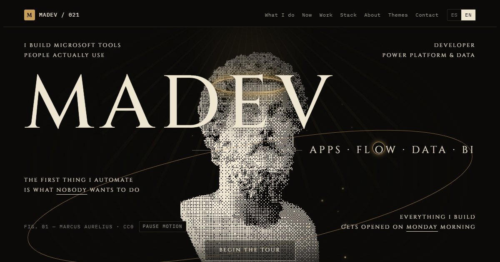
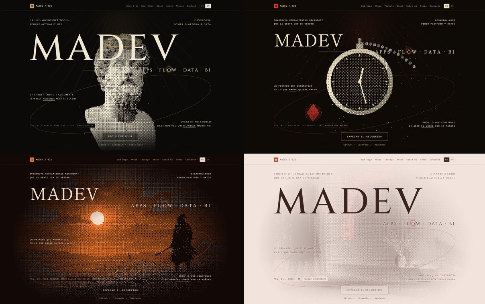
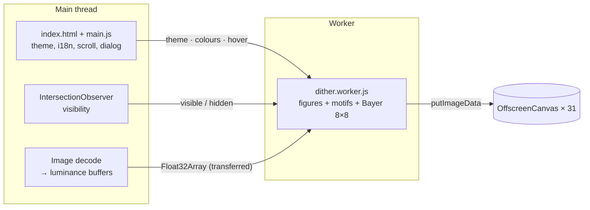

<div align="center">

# MADEV / 021

**Personal portfolio of Mamadou Diallo — software developer, Power Platform & data.**

[**mad0021.github.io**](https://mad0021.github.io) · Static site · No build step · No dependencies



</div>

## Overview

A single-page "system dossier" with a monumental hero: a dithered classical bust under a beam of
warm light, a halo, an orbit line and rising embers, set in Roman capitals. Every illustration is
rendered live in the browser with **ordered (Bayer 8×8) dithering**. Visitors can switch between
**31 themes**. Each theme restyles the whole page, not just the colours.

| | |
|---|---|
| **Stack** | HTML, CSS, vanilla JavaScript, Web Workers, `OffscreenCanvas` |
| **Hosting** | GitHub Pages, served as static files |
| **Languages** | Spanish / English, switchable at runtime |
| **Weight** | ~45 KB HTML, ~25 KB CSS, ~35 KB JS. Images are lazy and cached per theme |



## Features

- **Theme system.** 7 desktop themes plus 24 inspired by anime classics. A theme swaps the
  palette (CSS custom properties), the display typeface, the kanji seal in the nav and favicon,
  the section marks, the hero figure and the monogram. It is stored in `localStorage` and can be
  linked directly with `?theme=<id>`, for example
  [`?theme=red-august`](https://mad0021.github.io/?theme=red-august).
- **Procedural illustrations.** Each hero figure, glyph and theme card is a shade field
  `f(x, y, t) → [0, 1]` thresholded against a Bayer matrix. Photographs (the hero bust,
  wallpapers) go through the same pipeline from their luminance. Pixels close to the theme's
  accent colour keep that accent.
- **Scroll-driven sequence.** On desktop, the "What I do" section pins and scroll position steps
  through Apps → Flow → Data → BI.
- **Real screenshots.** The eTable gallery is dimmed at rest and shows full colour on hover or
  focus. A native `<dialog>` viewer supports keyboard navigation (← → Esc).

## Architecture



Every canvas is handed to a Web Worker with `transferControlToOffscreen()`. The pixel loops never
run on the main thread, so scrolling and input stay responsive while the figures animate.

- Only **visible** canvases are rendered (`IntersectionObserver`).
- **Theme cards** are drawn once and animate only while pointed at or focused.
- **Image figures** are static. They are recomputed only when the theme changes.

Measured in Chromium (1280×800, Long Tasks API):

| Section | Before (main-thread rendering) | After (worker) |
|---|---|---|
| Hero | ~190 ms blocked per frame | 0 long tasks |
| Theme gallery | ~100 ms blocked per frame | 0 long tasks |

## Accessibility

- Honours `prefers-reduced-motion`: no entrance animation, no scroll scrubbing, static figures.
- Skip link, landmark structure, visible `:focus-visible` styles, `aria-pressed` on toggles.
- Decorative canvases are `aria-hidden`. Meaningful ones carry an `aria-label` that follows the
  theme.
- The theme applies before first paint, so there is no flash of the wrong palette.

## Project structure

```
.
├── index.html              markup + inline theme boot script (runs before first paint)
├── css/main.css            design tokens, layout, 31 theme palettes
├── js/main.js              i18n, themes, scroll sequence, gallery, worker hand-off
├── js/dither.worker.js     dither engine: figures, motifs, render loop
├── assets/
│   ├── bust-marcus-aurelius.webp
│   ├── fonts/              Cinzel, Fraunces, Hanken Grotesk, IBM Plex Mono (woff2, OFL)
│   ├── themes/             desktop wallpapers (webp)
│   ├── etable/             eTable screenshots (webp)
│   └── og.jpg              social preview
└── docs/                   README images
```

## Run locally

The worker has to be served over HTTP, because `file://` blocks it.

```bash
python -m http.server 8000
```

Then open <http://localhost:8000>.

## Browser support

Current Chromium, Firefox and Safari 16.4+. Older browsers without `OffscreenCanvas` still get the
full page, but the decorative canvases stay empty.

## Credits

- **Hero bust:** *Marble Bust of Marcus Aurelius (Roman Emperor 161–180 AD)*, photo on
  [Wikimedia Commons](https://commons.wikimedia.org/wiki/File:Marble_Bust_of_Marcus_Aurelius_(Roman_Emperor_161-180_AD)_(28273837396).jpg),
  released under **CC0**. The background was removed and the photo is dithered at runtime.
- **Desktop wallpapers:** original artwork made for an earlier version of this portfolio.
- **Anime-inspired themes:** fan homages built from palettes and simple procedural shapes. They
  are not affiliated with or endorsed by the rights holders, and no frames, characters or logos
  are used.
- **Fonts:** Cinzel, Fraunces, Hanken Grotesk and IBM Plex Mono (self-hosted in `assets/fonts/`);
  Shippori Mincho B1 and Chakra Petch via Google Fonts, loaded only for themes that use them. All OFL.
- **Design references:** the editorial "system dossier" style of ryoku.dev and the monumental
  hero composition of the HVMANITY design on sceneai.art. No code, images or copy were taken from
  either.

## License

The source code is [MIT](LICENSE). Text content, the eTable screenshots and the wallpaper artwork
are © Mamadou Diallo and are not covered by the MIT license.

---

[GitHub](https://github.com/mad0021) · [LinkedIn](https://www.linkedin.com/in/madev021/)
